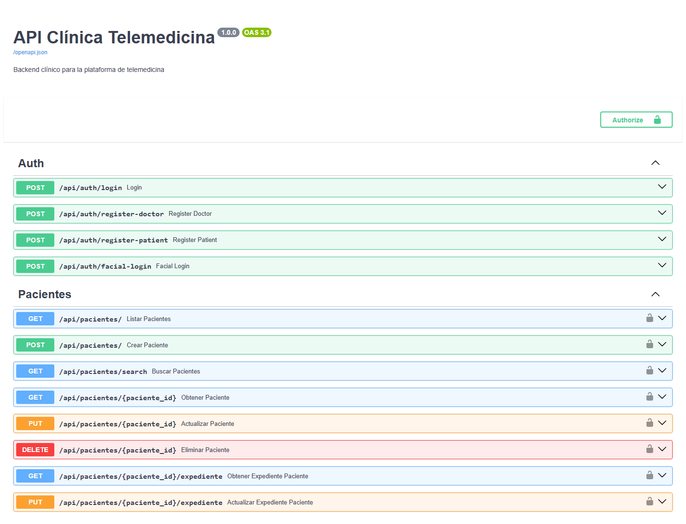

<p align="center">
  <a href="https://github.com/Nakusuo"></a>
</p>

# Telemedicina Integrada · Backend

La API detrás de nuestra clínica de telemedicina: guarda médicos, pacientes, citas y expedientes, **valida el login con la cara** y coordina las **videollamadas y llamadas telefónicas**.

La hicimos en equipo para el curso de **Laboratorio de Integración de Sistemas** (UTP). El portal web está en [Frontend-ClinicaBiometrica](https://github.com/Nakusuo/Frontend-ClinicaBiometrica).

<p align="center">
  
</p>

## Qué hace

- **Login con contraseña o con la cara.** El frontend manda un vector que describe el rostro (lo genera face-api.js) y aquí se compara con el guardado al registrarse. Si la distancia entre ambos es pequeña, se entrega un token JWT.
- **Médicos y pacientes**: registro, perfiles y disponibilidad.
- **Citas y expedientes**: agendar, consultas, recetas y exámenes.
- **Videollamadas**: el paciente solicita, el médico acepta y al terminar queda registrado.
- **Integración con telefonía**: se conecta (solo lectura) a la base de **FreePBX/Asterisk** para leer el historial de llamadas, y recibe sus eventos por webhook.

La idea del curso era justamente *integrar sistemas*: el navegador nunca habla directo con las bases de datos ni con la central telefónica, todo pasa por esta API.

## Con qué está hecho

Python 3.12, FastAPI, SQLAlchemy, PostgreSQL (o SQLite para pruebas), JWT, Docker y FreePBX/Asterisk.

```text
app/
├── routers/   # auth, pacientes, doctores, citas, expedientes, llamadas, webhooks, freepbx
├── models/    # tablas de SQLAlchemy
├── schemas/   # validación con Pydantic
├── core/      # configuración, seguridad (JWT) y comparación biométrica
└── db/        # conexión, migraciones y datos de prueba
migrations/    # esquema de la base (Alembic)
tests/         # pruebas con pytest
```

## Cómo correrlo

```bash
python -m venv venv
venv\Scripts\activate          # en Linux/Mac: source venv/bin/activate
pip install -r app/requirements.txt
cp .env.example .env           # y completa tus valores (SECRET_KEY es obligatoria)
uvicorn app.main:app --reload
```

Abre **http://127.0.0.1:8000/docs** para ver y probar todos los endpoints.

Si no configuras `DATABASE_URL`, usa un SQLite local. Al arrancar aplica sola las migraciones pendientes (`AUTO_MIGRATE=true`). Con `SEED_DEMO_DATA=true` carga datos de prueba: el médico `doctor@email.com` y la paciente `maria@email.com`, ambos con contraseña `password123`. En producción la API no arranca con datos de prueba ni con una `SECRET_KEY` insegura.

Con Docker (API + PostgreSQL):

```bash
docker compose up --build
```

Para montarlo en servidores con FreePBX, mira la guía [DEPLOY_UBUNTU.md](DEPLOY_UBUNTU.md).

## Migraciones

El esquema vive en `migrations/` (Alembic). Si cambias un modelo, genera la migración y revísala antes de subirla:

```bash
alembic revision --autogenerate -m "describe el cambio"
alembic upgrade head
```

## Pruebas

```bash
pip install -r requirements-dev.txt
ruff check .
pytest
```

Comprueban que cada usuario solo accede a lo suyo (pacientes, citas, expedientes, llamadas, WebSocket), que el login facial no se puede burlar, que la API no inventa datos clínicos y que las migraciones coinciden con los modelos. GitHub Actions corre lo mismo en cada PR.

<details>
<summary>Endpoints principales</summary>

| Grupo | Rutas |
|---|---|
| Auth | `POST /api/auth/login`, `POST /api/auth/facial-login`, `POST /api/auth/register-doctor`, `POST /api/auth/register-patient` |
| Pacientes | `/api/pacientes` (CRUD) |
| Doctores | `/api/doctores` (CRUD) |
| Citas | `/api/citas` (CRUD) |
| Expedientes | `/api/expedientes` (CRUD) |
| Llamadas | `POST /api/llamadas/solicitar`, `POST /api/llamadas/{cita_id}/aceptar`, `POST /api/llamadas/{cita_id}/terminar`, `GET /api/llamadas/` |
| Telefonía | `GET /api/freepbx/cdr`, `POST /api/webhooks/citas`, `POST /api/webhooks/asterisk-event` |

</details>
