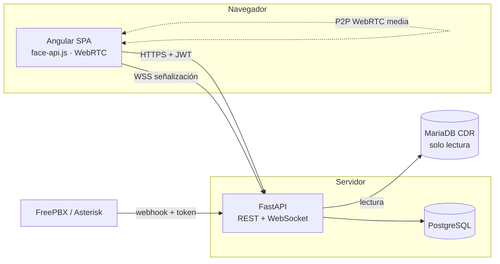

# Arquitectura e integración (TS / PI)

## Componentes

| Componente | Responsabilidad | Decisión |
|---|---|---|
| Angular SPA | Pantallas por rol, captura facial, videollamada | [ADR-0001](../adr/0001-arquitectura-api-y-spa.md), [ADR-0002](../adr/0002-biometria-en-el-navegador.md) |
| FastAPI | Reglas de negocio, permisos, señalización | ADR-0001 |
| PostgreSQL | Datos clínicos; esquema con Alembic | [ADR-0003](../adr/0003-migraciones-con-alembic.md) |
| FreePBX | Telefonía; la API solo lee su CDR y recibe eventos | RF-19, RF-20 |

## Interfaces

| Interfaz | Contrato | Seguridad |
|---|---|---|
| REST `/api/*` | Swagger en `/docs` | JWT Bearer, salvo login y registro (RNF-01) |
| WebSocket `/ws` | Mensajes `{type, target_role, target_id, data}` | El token va en el primer mensaje, no en la URL; solo participantes de la cita (RF-17) |
| Webhooks `/api/webhooks/*` | JSON de Asterisk | Encabezado `X-Webhook-Token` |
| CDR de FreePBX | Tabla `cdr` de `asteriskcdrdb` | Usuario MariaDB de solo lectura |

## Integración del producto (PI)

Orden de integración y cómo se verifica cada paso:

1. **API + base de datos:** las migraciones se aplican al arrancar (`AUTO_MIGRATE`). Se verifica con `test_migraciones.py` contra PostgreSQL en el CI.
2. **SPA + API:** login con contraseña → token → pantallas por rol. Se verifica con los tests del interceptor y del guard, y con la prueba de aceptación de [verificacion-validacion.md](verificacion-validacion.md).
3. **Videollamada:** dos navegadores con roles distintos en la misma cita.
4. **FreePBX:** en el servidor de despliegue ([DEPLOY_UBUNTU.md](../../DEPLOY_UBUNTU.md)).

Entornos: **local** (SQLite y `ng serve`), **CI** (SQLite y PostgreSQL en GitHub Actions) y **servidor** (Docker Compose y Nginx).
